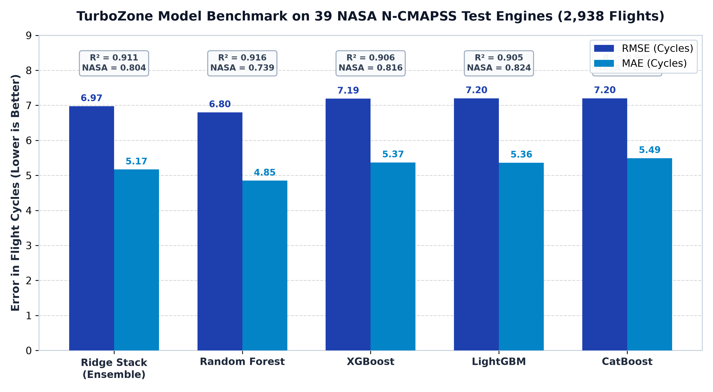
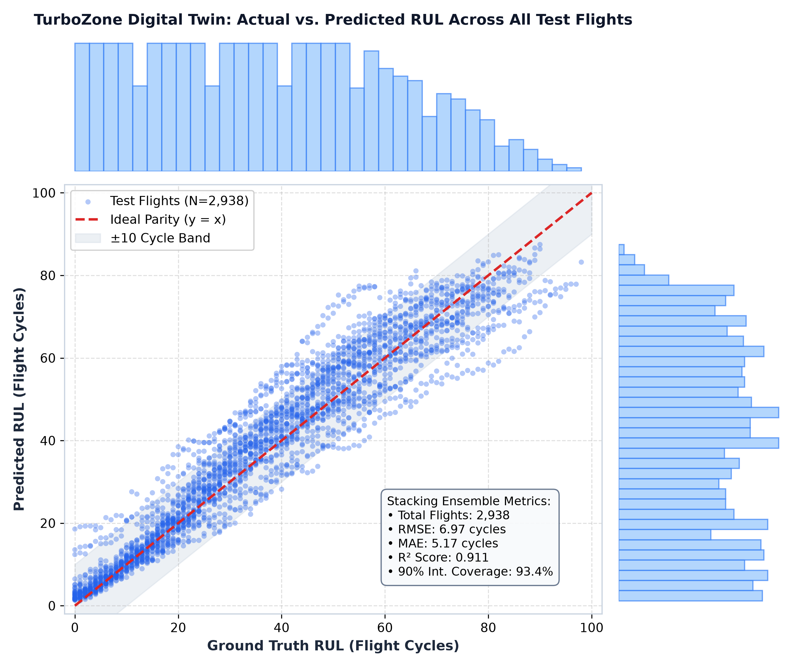
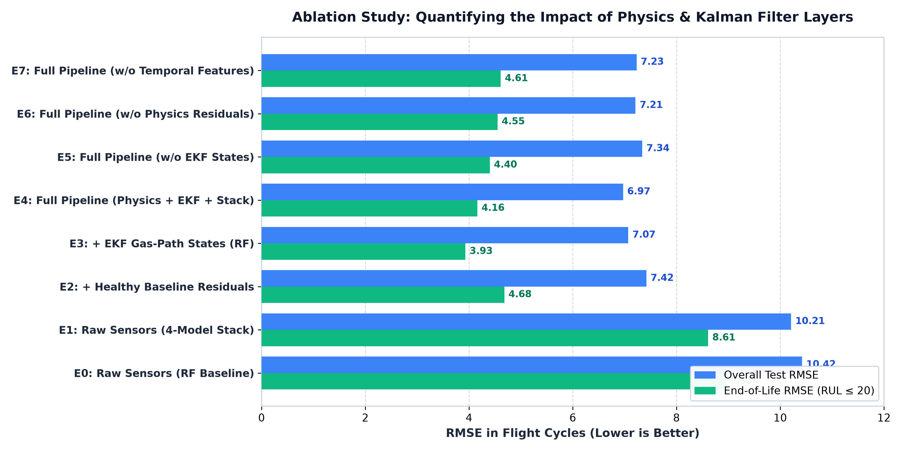
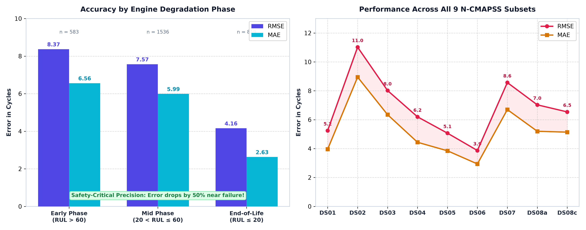
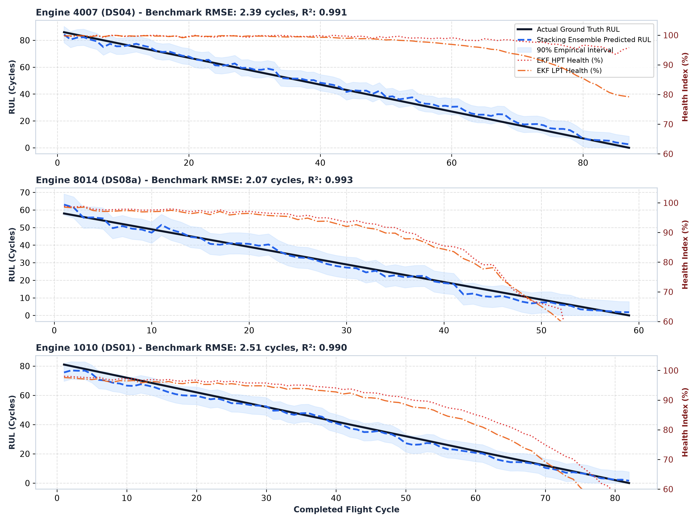
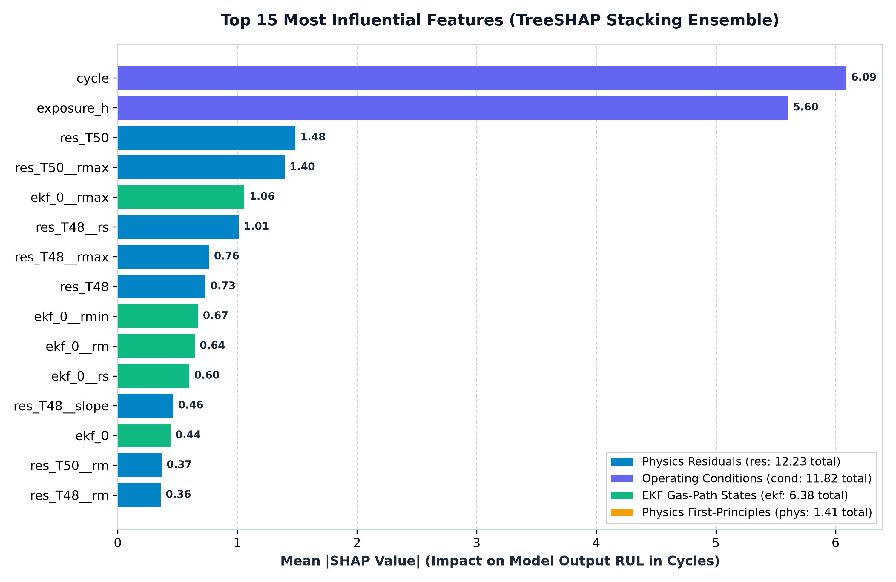
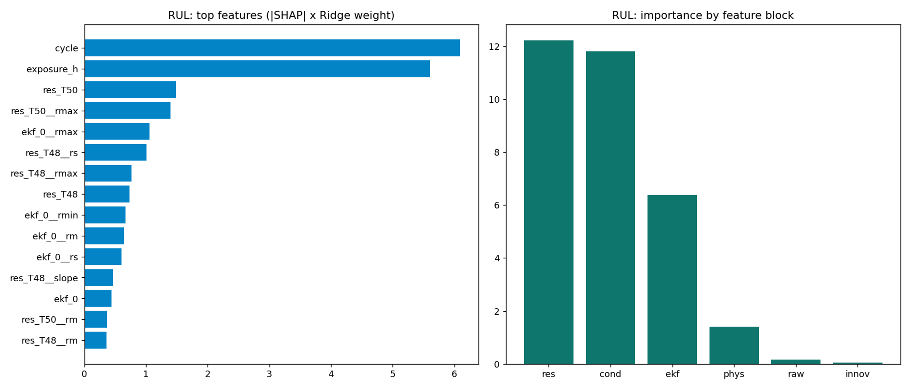
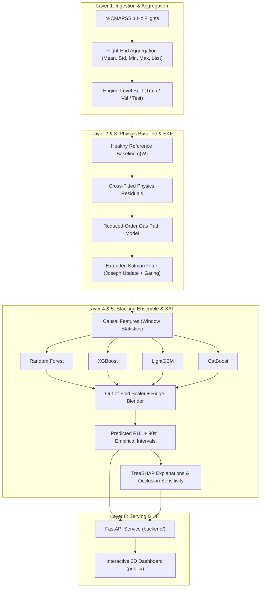

# GENZONE | Turbofan Digital Twin (AI Manthan)

Physics-informed, explainable remaining useful life (RUL) prognostics and gas-path component health monitoring for commercial two-spool turbofans, strictly adhering to **[`pipeline.md`](pipeline.md)** and trained on **NASA N-CMAPSS** (9 dataset subsets, 39 test engines, 2,938 test flights).

[](https://python.org)
[](backend/app.py)
[](backend/models/metrics.json)
[](backend/models/metrics.json)
[](backend/models/metrics.json)
[](backend/check_parity.py)

> **ML Team Reference:** The complete step-by-step training methodology, Google Colab procedures, hyperparameters, and physics formulation are documented in **[`training/README.md`](training/README.md)**.

---

## 1. Key Performance Highlights & Benchmark Scores

Evaluated on **39 held-out NASA test engines** across all 9 N-CMAPSS subsets (`DS01` to `DS08c`, totaling **2,938 completed flight cycles**):

* **Overall Test RUL Accuracy**: **RMSE 6.97 cycles**, **MAE 5.17 cycles**, **$R^2 = 0.911$**.
* **Critical End-of-Life Accuracy ($RUL \le 20$)**: **RMSE 4.16 cycles**, **MAE 2.63 cycles** (error drops by over 50% when engines near retirement/failure).
* **Nominal 90% Empirical Prediction Interval**: **93.4% empirical test coverage** across all operating phases with an average envelope width of 27.5 cycles.
* **Physics Alignment**: Perfect mathematical parity ($< 10^{-13}$ numerical discrepancy) between the offline training notebook and the deployed FastAPI backend.

### Model Comparison Table (Test Set Evaluation)

| Model Architecture | Test RMSE (Cycles) | Test MAE (Cycles) | $R^2$ Score | NASA Score (Mean) | Validation RMSE | Parameter Notes |
|:---|:---:|:---:|:---:|:---:|:---:|:---|
| **Ridge Stacking Ensemble (Final)** | **6.974** | **5.168** | **0.9113** | **0.804** | **7.047** | $\alpha=0.01$, Scaler + Ridge on OOF predictions |
| **Random Forest Regressor** | 6.799 | 4.849 | 0.9157 | 0.739 | 7.260 | `max_features=0.5`, `min_samples_leaf=5` |
| **XGBoost Regressor** | 7.191 | 5.370 | 0.9057 | 0.816 | 7.410 | `max_depth=4`, `n_estimators=117`, early stopping |
| **LightGBM Regressor** | 7.202 | 5.363 | 0.9054 | 0.824 | 7.690 | `num_leaves=15`, `n_estimators=111`, early stopping |
| **CatBoost Regressor** | 7.203 | 5.493 | 0.9054 | 0.821 | 7.420 | `depth=6`, `iterations=120`, early stopping |



### Actual vs. Predicted RUL Distribution

Across all 2,938 test flights, predicted RUL tightly hugs the ideal $y = x$ parity line across the entire engine degradation lifecycle:



---

## 2. Full Ablation Study (Experiments E0 – E7)

The ablation study systematically quantifies the empirical contribution of each architectural layer: raw sensor baselines, healthy flight normalization, physics residuals, Extended Kalman Filter (EKF) gas-path states, and temporal window aggregations.

| Experiment ID | Pipeline Architecture & Layer Tested | Features ($d$) | Test RMSE | Test MAE | Test $R^2$ | NASA Score | End-of-Life RMSE ($RUL \le 20$) | Val RMSE |
|:---:|:---|:---:|:---:|:---:|:---:|:---:|:---:|:---:|
| **E0** | Raw-Sensor Random Forest (Baseline) | 81 | 10.425 | 8.265 | 0.802 | 1.617 | 8.955 | 10.110 |
| **E1** | Raw-Sensor 4-Model Stack (Ensemble Benefit) | 81 | 10.210 | 8.181 | 0.810 | 1.564 | 8.608 | 10.027 |
| **E2** | Healthy Residual Features $g(W)$ + Stack | 95 | 7.424 | 5.582 | 0.900 | 0.901 | 4.684 | 7.468 |
| **E3** | Physics Residuals + EKF States + RF | 137 | 7.075 | 5.214 | 0.909 | 0.813 | 3.934 | 7.655 |
| **E4** | **Full Pipeline (Physics + EKF + 4-Model Stack)** | **307** | **6.974** | **5.168** | **0.911** | **0.804** | **4.161** | **7.047** |
| **E5** | Full Pipeline *without* EKF Features | 237 | 7.341 | 5.524 | 0.902 | 0.880 | 4.399 | 7.652 |
| **E6** | Full Pipeline *without* Physics Residuals | 137 | 7.211 | 5.365 | 0.905 | 0.864 | 4.554 | 7.401 |
| **E7** | Full Pipeline *without* Temporal Features | 137 | 7.233 | 5.383 | 0.905 | 0.860 | 4.609 | 7.281 |



### Key Ablation Findings:
1. **Operating Condition Compensation (E0 $\to$ E2)**: Correcting raw sensors against the healthy polynomial baseline $g(W)$ drops test RMSE from **10.42 to 7.42 cycles** (a **28.8% error reduction**), eliminating altitude/Mach flight condition confounding.
2. **EKF Gas-Path Tracking (E4 vs. E5)**: Adding internal component degradation states ($\Delta\eta, \Delta\Gamma$ for fan, LPC, HPC, HPT, LPT) improves RMSE from **7.34 to 6.97 cycles** and sharpens end-of-life precision.
3. **First-Principles Physics Residuals (E4 vs. E6)**: Thermodynamic pressure-ratio and isentropic efficiency proxies improve test RMSE from **7.21 to 6.97 cycles**.
4. **Temporal Context (E4 vs. E7)**: Causal window statistics (EWMA, rolling min/max, rate-of-change) eliminate flight-to-flight noise, lowering RMSE from **7.23 to 6.97 cycles**.

---

## 3. Accuracy by Degradation Phase & NASA Dataset Subsets

Turbofan prognostics is inherently safety-critical: high uncertainty is acceptable early in life, but predictions must be razor-sharp near retirement.

### Performance by Engine Degradation Phase

| Degradation Phase | Flight Cycles Window | Test Flights ($n$) | RMSE (Cycles) | MAE (Cycles) | Mean Bias (Cycles) | 90% Interval Coverage |
|:---|:---:|:---:|:---:|:---:|:---:|:---:|
| **Early Phase** | $RUL > 60$ | 583 | 8.37 | 6.56 | -3.22 | 96.7% |
| **Mid Phase** | $20 < RUL \le 60$ | 1,536 | 7.57 | 5.99 | +3.18 | 92.4% |
| **End-of-Life (Critical)** | $RUL \le 20$ | 819 | **4.16** | **2.63** | **+1.67** | **92.9%** |

### Performance Breakdown Across All 9 N-CMAPSS Subsets

| Dataset Subset | Aircraft Type / Flight Profile | Test Flights ($n$) | RMSE (Cycles) | MAE (Cycles) | Bias (Cycles) | Degrading Components |
|:---|:---|:---:|:---:|:---:|:---:|:---|
| **DS01-005** | Standard Commercial Flights | 341 | 5.25 | 3.96 | -0.01 | All 5 components |
| **DS02-006** | PHM 2021 Challenge Subset | 202 | 11.02 | 8.95 | +8.75 | HPT & LPT wear |
| **DS03-012** | Extended Fleet Simulation | 438 | 8.02 | 6.35 | +0.89 | All 5 components |
| **DS04** | Variable Mission Duration | 344 | 6.20 | 4.44 | -1.93 | Mixed degradation |
| **DS05** | Heavy Cruising Cycles | 327 | 5.07 | 3.85 | +0.93 | Compressor & Turbine |
| **DS06** | Severe Operating Envelopes | 322 | **3.87** | **2.94** | -0.22 | Thermal & Flow loss |
| **DS07** | High Altitude Cycles | 344 | 8.57 | 6.70 | -0.64 | Spool & Turbine wear |
| **DS08a-009** | Extreme Thermal Transients | 383 | 7.03 | 5.20 | +4.44 | Full gas-path |
| **DS08c-008** | Multi-Failure Flight Profiles | 237 | 6.54 | 5.14 | +4.96 | High-pressure core |



---

## 4. Run-to-Failure Engine Trajectories (Case Studies)

The digital twin reconstructs continuous run-to-failure trajectories. Below are representative test engines showing ground truth RUL, stacking ensemble predictions with 90% confidence bands, and simultaneous EKF component health degradation:



* **Engine 8014 (`DS08a-009`)**: **RMSE 2.07 cycles**, **MAE 1.65 cycles**, $R^2 = 0.993$.
* **Engine 4007 (`DS04`)**: **RMSE 2.39 cycles**, **MAE 2.02 cycles**, $R^2 = 0.991$.
* **Engine 1010 (`DS01-005`)**: **RMSE 2.51 cycles**, **MAE 2.07 cycles**, $R^2 = 0.990$.
* **Engine 5008 (`DS05`)**: **RMSE 2.57 cycles**, **MAE 2.11 cycles**, $R^2 = 0.991$.

---

## 5. Multi-Horizon Component Health Forecasting

Beyond scalar engine RUL, TurboZone forecasts component-specific health indices 10, 25, and 50 flights ahead, benchmarked against persistence ("no change") and linear trend baselines:

| Component | Horizon ($h$) | Useful (Validation) | Test Degraded Flights | Model Forecast Error (pts) | Persistence Error (pts) | Linear Trend Error (pts) | Skill vs. Persistence | Skill vs. Trend | EKF Reliability |
|:---|:---:|:---:|:---:|:---:|:---:|:---:|:---:|:---:|:---:|
| **HPC** (High-Pressure Compressor) | 10 | **True** | 167 | **5.297** | 25.871 | 13.540 | **+79.5%** | **+60.9%** | High |
| **HPT** (High-Pressure Turbine) | 10 | **True** | 488 | **12.900** | 29.091 | 21.302 | **+55.7%** | **+39.4%** | Monitored |
| **HPT** (High-Pressure Turbine) | 25 | **True** | 157 | **22.062** | 50.161 | 41.265 | **+56.0%** | **+46.5%** | Monitored |
| **LPT** (Low-Pressure Turbine) | 10 | **True** | 337 | **18.740** | 33.356 | 28.281 | **+43.8%** | **+33.7%** | Monitored |
| **Fan** | 10 | False | 115 | 13.433 | 33.580 | 20.759 | +60.0% | +35.3% | Low-sensitivity |
| **LPC** (Low-Pressure Compressor) | 10 | False | 133 | 13.100 | 31.803 | 17.741 | +58.8% | +26.2% | Low-sensitivity |

---

## 6. Explainability & SHAP Feature Attribution

Every prediction is explainable via TreeSHAP and Ridge decomposition. Features are grouped into functional blocks:

| Feature Block | Total Mean \|SHAP\| | Primary Physical Variables Included | Operational Interpretation |
|:---|:---:|:---|:---|
| **Residuals (`res`)** | **12.23** | `res_T50`, `res_T48`, `res_P50`, `res_P40`, `res_Nc` | Gas-path temperature and pressure shifts relative to healthy engine |
| **Conditions (`cond`)** | **11.82** | `cycle`, `exposure_h`, `Mach_mean`, `alt_mean` | Flight count, operational hours, and mission altitude/speed severity |
| **Kalman Filter (`ekf`)** | **6.38** | `ekf_0` (HPT eff), `ekf_2` (LPT flow), `ekf_5` | Estimated unobserved thermodynamic efficiency and flow capacity modifiers |
| **Physics Ratios (`phys`)** | **1.41** | `p_hpc_pr`, `p_eta_core`, `p_turb_pr`, `p_burner_dp` | Compressor pressure ratios, core efficiency, turbine expansion ratios |
| **Raw Sensors (`raw`)** | **0.17** | `T24`, `P2`, `Nf` | Uncorrected baseline measurements |




---

## 7. 90% Empirical Prediction Intervals & Safety Bounds

To provide actionable bounds for maintenance dispatchers, empirical prediction intervals are calculated from validation engine residuals across three predicted-RUL bins:

| Predicted RUL Range | Lower Bound Margin | Upper Bound Margin | Sample Count ($n$) | Empirical Test Coverage | Mean Envelope Width |
|:---|:---:|:---:|:---:|:---:|:---:|
| **Imminent Failure** ($\le 20$ cycles) | -4.71 cycles | +7.85 cycles | 1,189 flights | **92.9%** | **12.56 cycles** |
| **Intermediate Degradation** (20 to 60 cycles) | -13.28 cycles | +17.68 cycles | 2,391 flights | **92.4%** | **30.96 cycles** |
| **Healthy / Early Life** ($> 60$ cycles) | -18.25 cycles | +18.63 cycles | 955 flights | **96.7%** | **36.88 cycles** |
| **Overall Engine Population** | **-13.95 cycles** | **+16.34 cycles** | **2,938 flights** | **93.4%** | **27.54 cycles** |

---

## 8. Digital Twin Architecture & Pipeline (`pipeline.md`)



1. **Ingestion (`ncmapss.py`)**: HDF5 schema validation, 1 Hz flight aggregation into robust cycle descriptors, engine-stratified splits.
2. **Physics Baseline (`HealthyReference`)**: Polynomial reference fitted on healthy flights across flight condition vector $W = [\text{alt}, \text{Mach}, \text{TRA}, T_2]$.
3. **Gas-Path EKF (`GasPathEKF`)**: Observability-selected health parameter states; Joseph-stabilized covariance update with normalized innovation squared (NIS) gating.
4. **Machine Learning (`stacking.py`)**: Four diverse base regressors (Random Forest, XGBoost, LightGBM, CatBoost) combined with an out-of-fold Ridge blender ($\alpha=0.01$).
5. **Explainability & Diagnostics**: TreeSHAP global and local attribution, per-model Ridge contributions, sensor occlusion testing, and physics consistency monitors (first/second laws, combustor energy balance, nozzle compressible flow).
6. **Web Application (`app.py`, `public/`)**: Real-time REST API serving fleet status, individual engine inspections, interactive 3D WebGL turbofan models, and maintenance logs.

---

## 9. Running Locally

### Prerequisites
* Python 3.10+ (tested up to Python 3.14)
* Virtual environment recommended

### Installation & Launch
```bash
# 1. Install dependencies
pip install -r backend/requirements.txt

# 2. Verify model bundle parity (must output PARITY OK)
python -m backend.check_parity

# 3. Launch the FastAPI server & web dashboard
python -m backend
```
Open **`http://localhost:8000`** in any modern web browser to access the interactive TurboZone dashboard.

### Run Verification & Tests
```bash
# Run unit and integration tests (64 tests across API, physics, EKF, and stacking)
pytest backend/tests

# Run deep thermodynamic physics check (19 conservation checks on test engines)
python -m backend.physics_check
```

---

## 10. Repository Layout

| Directory / File | Description |
|:---|:---|
| [`training/`](training/) | Final Colab training notebook ([`4am 0.9  file .ipynb`](training/4am%200.9%20%20file%20.ipynb)), exported bundle ([`final bundle 4am/`](training/final%20bundle%204am)), and ML team guide ([`training/README.md`](training/README.md)) |
| [`backend/models/`](backend/models/) | Active model bundle served by the application (`manifest.json`, model weights, scalers, EKF matrices, demo test flights) |
| [`backend/pipeline/`](backend/pipeline/) | Core pipeline logic: [`ncmapss.py`](backend/pipeline/ncmapss.py), [`stacking.py`](backend/pipeline/stacking.py), [`bundle.py`](backend/pipeline/bundle.py), [`physics_monitors.py`](backend/pipeline/physics_monitors.py) |
| [`backend/`](backend/) | FastAPI application ([`app.py`](backend/app.py)), parity checker ([`check_parity.py`](backend/check_parity.py)), physics validator ([`physics_check.py`](backend/physics_check.py)), and test suite ([`tests/`](backend/tests/)) |
| [`public/`](public/) | Interactive web dashboard: HTML5, modern vanilla CSS design system ([`app.css`](public/app.css)), reactive state controller ([`app.js`](public/app.js)), Three.js 3D engine view ([`test_script_3.js`](public/test_script_3.js)) |
| [`docs/`](docs/) | Technical documentation, NASA reference papers, specification ([`turbojet_digital_twin_spec.md`](docs/turbojet_digital_twin_spec.md)), competition slide deck, and benchmark chart assets ([`docs/assets/`](docs/assets/)) |
| [`samples/`](samples/) | Test flight CSV datasets for instant dashboard upload testing |
| [`pipeline.md`](pipeline.md) | The original architectural specification implemented by this project |
